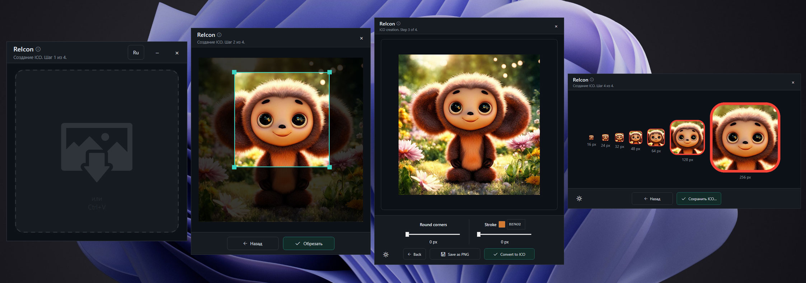

# ReIcon

**English** · [Русский](#русский)

A small Windows utility that converts images to **ICO** or **PNG** — with transparency, cropping, rounded corners, an outline and a live preview before saving.



## Download

Get the latest `ReIcon.exe` on the [Releases](../../releases) page.  
It is a **self-contained** build — no need to install .NET.

## Features

- **Drag and drop / paste** — drop an image file or press Ctrl+V
- **Cropping** — pick and adjust the area for the icon
- **Rounded corners** — corner radius with a real-time preview
- **Outline** — adjustable border and color picker (eyedropper, presets, HSV wheel, hex input)
- **ICO export** — multi-size ICO (256 / 64 / 48 / 32 / 16 px) with transparency
- **PNG export** — save the processed image as PNG at the original resolution
- **Light / dark preview background** — see how the icon looks on different surfaces
- **Languages** — English and Russian; picked from the system language

Supported input formats: PNG, JPEG, WebP, BMP, GIF, TIFF, TGA (via ImageSharp).

## Building from source

**Requires:** [.NET 6 SDK](https://dotnet.microsoft.com/download/dotnet/6.0) (or newer).

```bash
# Clone the repository
git clone https://github.com/dinosmike/ReIcon.git
cd ReIcon

# Publish a single executable (self-contained)
dotnet publish ReIcon/ReIcon.csproj -c Release -r win-x64 --self-contained true ^
    -p:PublishSingleFile=true -p:IncludeNativeLibrariesForSelfExtract=true ^
    -p:EnableCompressionInSingleFile=true -p:DebugType=None -o publish

# Or just run the script
build-release.bat
```

The ready `ReIcon.exe` is in the `publish/` folder.

## Stack

- **WPF** (.NET 6, Windows only)
- **SixLabors.ImageSharp** — image loading and processing
- **System.Drawing.Common** — fallback for icon extraction

## License

Provided "as is" for personal and educational use.

## Author

**Mikhail Krylov** — [Telegram](https://t.me/mihail_krylov) · [GitHub](https://github.com/dinosmike)

---

## Русский

Небольшая утилита для конвертации изображений в **ICO** или **PNG** — с поддержкой альфа-канала, обрезкой, скруглением углов, обводкой и предпросмотром перед сохранением.

## Скачать

На странице [Releases](../../releases) возьмите последний `ReIcon.exe`.  
Сборка **self-contained** — отдельно ставить .NET не нужно.

## Возможности

- **Перетаскивание / вставка** — перетащите файл изображения или нажмите Ctrl+V
- **Обрезка** — выбор и настройка области под иконку
- **Скругление углов** — радиус скругления с предпросмотром в реальном времени
- **Обводка** — настраиваемый контур и выбор цвета (пипетка, пресеты, круг HSV, ввод hex)
- **Экспорт ICO** — многоразмерный ICO (256 / 64 / 48 / 32 / 16 px) с поддержкой прозрачности
- **Экспорт PNG** — сохранение обработанного изображения в PNG в оригинальном разрешении
- **Светлый / тёмный фон превью** — переключение фона, чтобы оценить вид иконки на разных поверхностях
- **Локализация** — английский и русский; язык подбирается по системе

Поддерживаемые форматы на входе: PNG, JPEG, WebP, BMP, GIF, TIFF, TGA (через ImageSharp).

## Сборка из исходников

**Нужно:** [.NET 6 SDK](https://dotnet.microsoft.com/download/dotnet/6.0) (или новее).

```bash
# Клонировать репозиторий
git clone https://github.com/dinosmike/ReIcon.git
cd ReIcon

# Опубликовать один исполняемый файл (self-contained)
dotnet publish ReIcon/ReIcon.csproj -c Release -r win-x64 --self-contained true ^
    -p:PublishSingleFile=true -p:IncludeNativeLibrariesForSelfExtract=true ^
    -p:EnableCompressionInSingleFile=true -p:DebugType=None -o publish

# Или просто запустить скрипт
build-release.bat
```

Готовый `ReIcon.exe` лежит в папке `publish/`.

## Стек

- **WPF** (.NET 6, только Windows)
- **SixLabors.ImageSharp** — загрузка и обработка изображений
- **System.Drawing.Common** — резерв для извлечения иконок

## Лицензия

Проект распространяется «как есть» для личного и учебного использования.

## Автор

**Михаил Крылов**

- Telegram: [@mihail_krylov](https://t.me/mihail_krylov)
- GitHub: [dinosmike](https://github.com/dinosmike)
